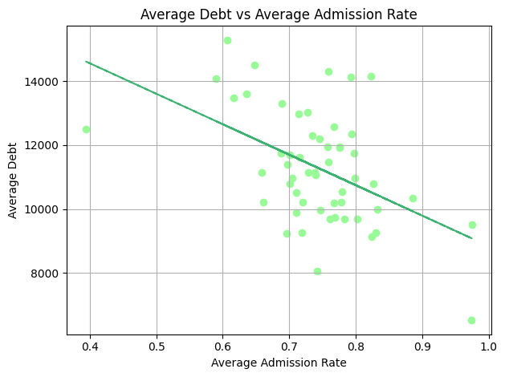
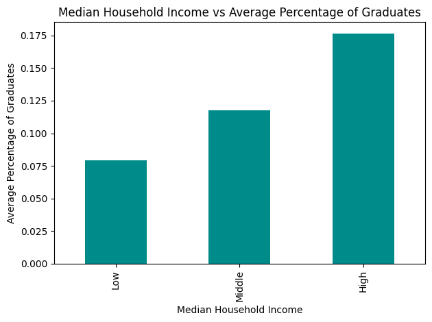
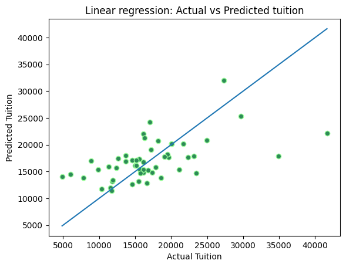

# CS2316: College Costs, Student Debt, and State Education Patterns

A Spring 2026 data science project by **Khush Desai and Bhakti Gajjar**.

How do college tuition and student debt compare with household income and educational attainment across the United States? This project combines College Scorecard institution records, Census household income estimates, and state educational attainment data. It uses Python, pandas, NumPy, Beautiful Soup, Matplotlib, and scikit-learn for collection, cleaning, aggregation, regression, and clustering.

## Start here

| Material | Contents |
| --- | --- |
| [Final notebook](PhaseIII_DesaiGajjar58.ipynb) | Original analysis, five insights, three charts, explanations, and saved tables/outputs |
| [Collection notebook](phaseII.ipynb) | CSV cleaning, Census API collection, HTML scraping, and data preparation |
| [Results and tables](docs/results.md) | Readable findings, model statistics, rankings, and cluster summaries |
| [All result CSVs](results/) | State table, rankings, model predictions, cluster assignments, and chart data |
| [Poster](docs/poster.pdf) | Original one-page project summary |
| [Presentation](docs/presentation.pdf) | Original 21-slide presentation |
| [Data guide](docs/data.md) | Sources, definitions, units, missing values, snapshot details, and raw data instructions |
| [Data manifest](data/manifest.json) | File hashes, record counts, and package versions used for reproduction |
| [Recorded presentation](https://youtu.be/fM9PhJFS2rw) | Link supplied in the original final notebook |

## Findings

The analysis uses **6,429 institutions**. The merged table retains 59 jurisdiction codes; regression and clustering use 52 complete observations, covering the 50 states, Washington, DC, and Puerto Rico.

- Vermont has the highest average in-state tuition relative to median household income: **53.38%**. This aggregate indicator is not an individual student's net price.
- Vermont also has the largest private nonprofit versus public tuition gap: approximately **$38,643**.
- Average institutional debt and graduation rate have a correlation of **0.3576**; debt relative to household income and graduation rate have a correlation of **-0.0116**.
- A regression using income and bachelor's attainment explains **32.91%** of in-sample tuition variation across 52 observations. This is not a held-out accuracy estimate.
- The original K-means model forms three groups from tuition, debt, income, and attainment. Its features are unscaled, so dollar-valued variables dominate distance calculations.

See the [results](docs/results.md) for numerical tables and interpretation limits.

## Graphs

### Average admission rate and student debt



Each point is a jurisdiction with available data. The line summarizes an association between institutional averages.

### Household income and advanced degree attainment



Income groups divide the observed income range into three equal-width intervals. The original chart's term "graduates" refers to adult residents with an advanced degree, not the institutional graduation rate.

### Actual and predicted tuition



Predictions use the same observations used to fit the model. The diagonal represents perfect agreement.

## Included data

| File | Records |
| --- | --- |
| [Cleaned Scorecard](cleaned_scorecard.csv) | 6,429 institutions, 11 fields |
| [Cleaned Census income](cleaned_census_income.csv) | 52 jurisdictions, 5 fields |
| [Cleaned educational attainment](cleaned_html_data.csv) | 52 jurisdictions, 9 fields |
| [Full original Scorecard CSV, compressed](data/raw/Most-Recent-Cohorts-Institution.csv.gz) | 6,429 institutions, 3,306 fields; lossless gzip |
| [Merged analysis](results/state_analysis.csv) | 59 jurisdiction rows, 16 fields, including missing values |

These are published institution statistics and state aggregates. Institution ZIP codes and locations describe colleges, not project authors or individual students. The [manifest](data/manifest.json) records the original raw CSV's SHA-256.

## Run locally

Use Python 3.10 or later from the repository directory:

```sh
python -m venv .venv
# Windows: .venv\Scripts\activate
# macOS/Linux: source .venv/bin/activate
python -m pip install -r requirements.txt
python run_analysis.py
```

The runner executes the original final notebook's analysis against the included cleaned snapshots, skips Colab mounting and live collection, and writes three charts plus all numerical exports to `generated/`. Published tables in `results/` are a checked-in reproduction snapshot. Package versions used for reproduction are in the manifest.

For Jupyter, run `jupyter lab`. In the final notebook, skip the Colab mount and collection cells, then start at **SETUP FOR INSIGHTS** with the repository as the working directory. Original code and saved outputs are preserved; Colab session metadata has been removed.

The [data guide](docs/data.md) explains how to extract the original raw CSV. Live web responses can change; supplied snapshots reproduce the submitted analysis without network access.

## Sources and limitations

Sources: [College Scorecard](https://collegescorecard.ed.gov/data/), [2023 Census ACS API](https://api.census.gov/data/2023/acs/acs5.html), and [Wikipedia educational attainment by state](https://en.wikipedia.org/wiki/List_of_U.S._states_and_territories_by_educational_attainment).

This exploratory course project uses unweighted institution averages, differing source periods, and some imputed values. Associations do not establish causation. "Private" in the sector comparison means private nonprofit (`CONTROL = 2`). The original collection code has loop-variable mistakes in admission/SAT imputation and rounding; the submitted cleaned snapshots are retained rather than silently rewritten. Read the [data guide](docs/data.md) before interpreting or extending the results.

The poster and slides preserve the submitted wording. The notes here clarify model scope and terminology. Public materials were reviewed for credentials, private contact details, notebook metadata, PDF metadata/links, and Git history. Videos, checkpoints, exams, homework, and unrelated personal files are excluded.
